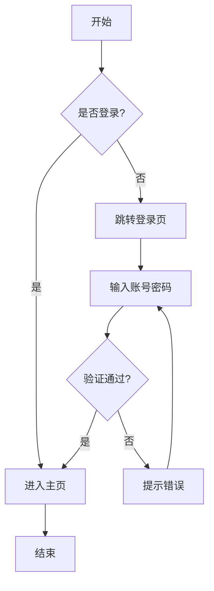
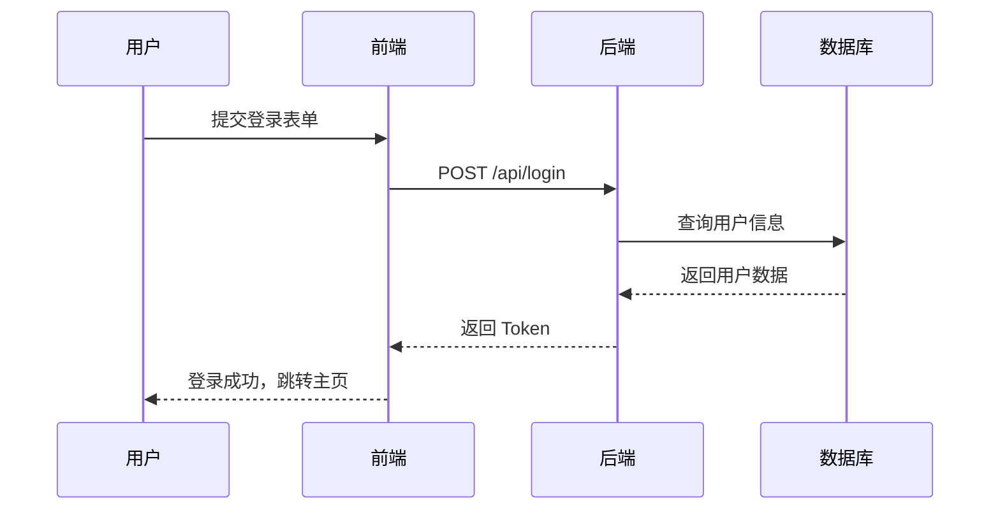
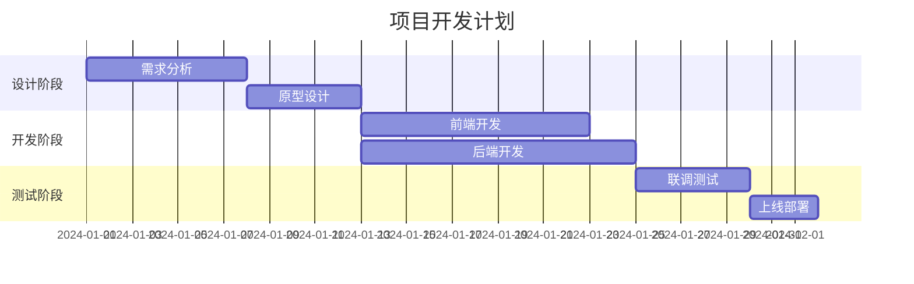

# Markdown 语法渲染测试

这是一份用于测试 Markdown 渲染效果的示例文档。

## 1. 标题

# H1 一级标题
## H2 二级标题
### H3 三级标题
#### H4 四级标题
##### H5 五级标题
###### H6 六级标题

## 2. 文本样式

普通文本

**加粗文本**

*斜体文本*

***加粗斜体文本***

~~删除线文本~~

`行内代码`

> 引用文本
>
> > 嵌套引用

## 3. 列表

### 无序列表

- 项目一
- 项目二
  - 子项目 A
  - 子项目 B
- 项目三

### 有序列表

1. 第一项
2. 第二项
   1. 子项一
   2. 子项二
3. 第三项

### 任务列表

- [x] 已完成任务
- [ ] 未完成任务
- [ ] 待办事项

## 4. 代码

行内代码：`console.log("Hello, World!")`

代码块：

```javascript
function greet(name) {
  console.log(`Hello, ${name}!`);
}

greet("Markdown");
```

```python
def add(a, b):
    return a + b

print(add(1, 2))
```

## 5. 表格

| 姓名 | 年龄 | 城市 |
|------|------|------|
| 张三 | 25   | 北京 |
| 李四 | 30   | 上海 |
| 王五 | 28   | 广州 |

对齐方式：

| 左对齐 | 居中对齐 | 右对齐 |
|:-------|:--------:|-------:|
| A      | B        | C      |
| 1      | 2        | 3      |

## 6. 链接与图片

[OpenAI](https://www.openai.com)

<https://www.example.com>


## 7. 分隔线

---

***

___

## 8. 转义字符

\*这不是斜体\*

\`这不是代码\`

## 9. HTML 标签

<details>
<summary>点击展开</summary>

这里是折叠内容。

</details>

<br>

<kbd>Ctrl</kbd> + <kbd>C</kbd>

## 10. 脚注

这是一个带脚注的句子[^1]。

[^1]: 这是脚注的内容。

## 11. 数学公式（部分渲染器支持）

行内公式：$E = mc^2$

块级公式：

$$
\int_{a}^{b} f(x)\,dx
$$

## 12. 流程图

### Mermaid 流程图



### Mermaid 时序图



### Mermaid 甘特图



### 纯文本 ASCII 流程图

```
┌─────────┐     ┌─────────┐     ┌─────────┐
│  开始   │────▶│  处理   │────▶│  结束   │
└─────────┘     └─────────┘     └─────────┘
```

## 13. 引用代码与混合内容

> **注意**：这是一段引用中的加粗文本。
>
> ```js
> const x = 1;
> ```

---

**测试结束，感谢阅读！**
